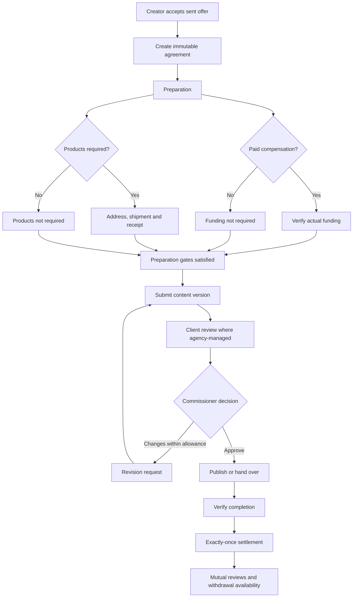

# Insight — complete application rebuild blueprint

**Date:** 9 November 2026  
**Status:** Planning specification. This document does not claim the existing prototype is a completed implementation.  
**Source of scope:** The supplied five-page feature PDF, the original visual reference, and the user's ten corrections.  
**Required stack:** React + Tailwind CSS in JavaScript; Node.js + Express + Mongoose in JavaScript. No TypeScript.  
**Brand:** Insight; primary `#003b59`, secondary `#ffb118`.

The delivery target is a database-backed application with dedicated modules, schemas, policies, services, controllers, routes and screens. The current generic `Marketplace.data` object, `/api/actions/:action` dispatcher and browser-local business state are a prototype baseline, not the target backend.

The implementation is accepted only when each requirement has a screen, route, schema/service, permission rule and passing real-database acceptance evidence. A mock-storage test result or clickable demo is insufficient for that sign-off.

## 1. Scope inventory

This blueprint defines **45 dedicated Mongoose models**, **186 explicit API routes** and **111 named screens/views**. Modals and responsive versions may share components, but their behavior and data paths must still be implemented. Routes below are all under `/api/v1` unless stated otherwise.

Four portal families remain: creator/influencer, brand, agency (including its independently authorized client-review views), and owner. One human can hold more than one membership; switching context changes the selected workspace, not the person's identity or authority.

### What can be retained

- Insight colours, typography, layout direction and reusable presentational components.
- The original sample media as explicit development/test fixtures.
- Workflow cases already discovered in earlier tests, rewritten against the new API/database architecture.

### What must be replaced

- The whole-marketplace `Schema.Types.Mixed` record and all-array mutation service.
- The generic business-action dispatcher as the primary feature API.
- Production role switching and frontend imports of backend domain/seed logic.
- Static seeded review counts, rates or financial totals presented as live facts.
- Tests that substitute memory storage when claiming database integration is verified.
- The single large screen file as the permanent frontend module structure.

## 2. Module boundaries and repository structure

Each business module owns route registration, input/output schemas, controllers, services, repositories, policies and tests. Shared infrastructure provides authentication, transactions, errors, storage, audit, idempotency and outbox processing. Controllers do not mutate Mongoose records directly.

```text
server/src/app.js
server/src/server.js
server/src/config/
server/src/middleware/
server/src/infrastructure/database/
server/src/infrastructure/media/
server/src/infrastructure/outbox/
server/src/infrastructure/idempotency/
server/src/modules/<module>/<module>.model.js
server/src/modules/<module>/<module>.validation.js
server/src/modules/<module>/<module>.repository.js
server/src/modules/<module>/<module>.policy.js
server/src/modules/<module>/<module>.service.js
server/src/modules/<module>/<module>.controller.js
server/src/modules/<module>/<module>.routes.js
server/src/modules/<module>/<module>.test.js
server/tests/integration/
server/tests/fixtures/
web/src/app/routes.jsx
web/src/app/providers/
web/src/api/http.js
web/src/features/<feature>/api.js
web/src/features/<feature>/pages/
web/src/features/<feature>/components/
web/src/features/<feature>/hooks/
web/src/components/
web/src/styles/
docs/openapi.yaml
docs/feature-traceability.md
docs/acceptance-results.md
```

### Required modules

| Module                         | Responsibilities                                                                                                                               |
| ------------------------------ | ---------------------------------------------------------------------------------------------------------------------------------------------- |
| Identity and sessions          | Registration, email verification, login, credential recovery/change, rotation/revocation, current human identity and suspended account checks. |
| Organizations and profiles     | Actual brand/agency records, contacts, logos and safe public projections.                                                                      |
| Memberships and invitations    | Multiple memberships, client/campaign permissions, new/existing-account acceptance, revocation.                                                |
| Creators and portfolio         | Social handles, measured/self-reported metrics, audience, rates, portfolio and public work history.                                            |
| Agency clients                 | Client relationships, delegated access, archive behavior, client financial context.                                                            |
| Discovery and saves            | Creator/campaign search, creator shortlists per client, private saved campaigns.                                                               |
| Campaigns and moderation       | Versioned briefs, client approval, platform review, publication, closure and capacity.                                                         |
| Applications                   | Pitches, rates, response tracking, withdrawal and decline.                                                                                     |
| Offers and agreements          | Direct/linked proposals, independent client sign-off, sending, acceptance and immutable accepted terms.                                        |
| Collaborations and assignments | Shared work lifecycle, preparation readiness, responsibility and allowed next actions.                                                         |
| Client approvals               | Human reviewer identities, protected sharing, immutable revision/version decisions and invalidation.                                           |
| Products and shipping          | Agreed packages, private addresses, original/replacement shipments, receipt, issues and Q&A.                                                   |
| Media                          | Real private uploads, metadata validation, playback/range requests and retained evidence.                                                      |
| Content review and revisions   | Version history, timestamp notes, included/extra rounds, consent and final content approval.                                                   |
| Completion and settlement      | Live publishing/handover, correction, verification and exactly-once closeout.                                                                  |
| Messaging                      | Context-linked conversations, named senders, private client threads and message history.                                                       |
| Finance and agency charges     | Ledger, held funds, funding verification, reservations, payouts, refunds and separate service charges.                                         |
| Disputes and reviews           | Evidence, freezing, owner resolution and one post-settlement review per side.                                                                  |
| Notifications and audit        | Per-human inbox/read state, reliable contextual events and immutable decision history.                                                         |
| Dashboards and reports         | Scope-safe server aggregates, cross-client overview, campaign/client exports.                                                                  |
| Owner administration/settings  | Verification/suspension, queues, finance oversight, future commission defaults and formats.                                                    |

## 3. Identity, tenancy and permission rules

**Identity:** `User._id` always identifies the human. An agency organization ID must never substitute for that user's ID in messages, reviews, approvals or audit logs.

**Request scope:** Authenticate the session, resolve its current active memberships, validate requested organization/client context, then intersect campaign/direct-collaboration grants. Recheck live data after membership changes. A URL ID or browser role flag is never an authorization grant.

| Action                                                  | Creator          | Brand administrator             | Agency admin/authorized manager                         | Client reviewer                        | Owner                                             |
| ------------------------------------------------------- | ---------------- | ------------------------------- | ------------------------------------------------------- | -------------------------------------- | ------------------------------------------------- |
| Discover approved briefs / public creator profiles      | Yes              | Yes                             | Yes within working context                              | Only authorized review context         | Oversight                                         |
| Create/submit a campaign or send an offer               | No               | Own brand                       | Assigned client/campaign; admin for creating new grants | No                                     | No creative commissioning by default              |
| Accept/decline an offer                                 | Assigned creator | No                              | No                                                      | No                                     | No                                                |
| Client brief/offer/content decision                     | No               | Commissioning client identity   | Cannot approve its own prepared work                    | Explicitly assigned, independent human | Cannot substitute for client approval             |
| Fund/ship/revise/approve final/verify completion/settle | No               | Own brand                       | Authorized commissioning context                        | No financial/final-agency action       | Funding reconciliation and dispute decisions only |
| Submit content, confirm receipt, publish/handover       | Assigned creator | No                              | No                                                      | No                                     | No                                                |
| Comment on authorized content                           | Yes              | Yes                             | Yes                                                     | Yes                                    | Read-only oversight                               |
| Invite/edit access/assign responsibilities              | No               | Own organization administrators | Agency administrator only                               | No                                     | Platform account controls only                    |
| Process actual funding/payout/refund records            | No               | Submit reference                | Submit reference in scope                               | No                                     | Yes                                               |

Rules that must be shared across services:

1. Internal proposal drafts never appear in creator discovery, notifications or deal lists before being sent.
2. Agency client shortlists are unique by `(agencyOrganizationId, clientBrandOrganizationId, creatorProfileId)`.
3. A campaign manager assigned campaign A cannot access campaign B merely because both belong to the same client.
4. Direct collaborations need an all-work grant or explicit collaboration grant.
5. Assignment uses membership IDs, not mutable teammate names, and is an administrator action.
6. An independent client decision must reference an exact immutable revision/version. Changing the target invalidates the prior decision.
7. A person cannot approve a brief/offer they prepared by switching to another of their own memberships.
8. Owner access does not make the owner a creative approver; the commissioning party approves content, the creator submits/publishes, and the owner resolves disputes.
9. Each private resource read revalidates its parent scope, including media, comments, messages and evidence.
10. User suspension and membership revocation take effect on subsequent requests, not only after logging out.
11. Reviewer-facing pages never expose team grant editors or payment-processing controls.
12. Existing users can accept invitations without losing their creator profile or memberships in other organizations.
13. Retain at least one active organization administrator when revoking or changing an administrator membership.
14. Approval policy defaults to ANY_ASSIGNED: one authorized independent client decision is sufficient. ALL_ASSIGNED requires every assigned reviewer. A change request closes/supersedes that target request; no later approval can silently override it.
15. Campaign public search fields are derived from the published revision, not an agency's unapproved draft. Collaboration due dates are a read-only projection of the accepted agreement.
16. Display self-reported portfolio brand credits separately from platform-verified completed project counts.

## 4. Dedicated models, fields, indexes and invariants

All models use `timestamps`, strict schemas, explicit enums, length/range validation and ObjectId references. Typed subdocuments are permitted; no `Schema.Types.Mixed` business-state container. Money uses integer paise and currency codes. All mutable records use optimistic concurrency/version checks. Accepted commercial and financial history has no destructive update/delete API. Indexes are created and verified during deployment, not assumed from UI behavior.

### `User` — Identity

- **Fields:** email:String; emailNormalized:String; passwordHash:String(select:false); name:String; status:ACTIVE/SUSPENDED; platformRole:USER/OWNER; emailVerifiedAt:Date?.
- **Indexes:** unique(emailNormalized).
- **Invariant:** One human identity; public registration cannot assign OWNER or permissions.

### `Session` — Identity

- **Fields:** userId:ref User; refreshTokenHash:String; expiresAt:Date; revokedAt:Date?; userAgent:String?.
- **Indexes:** TTL(expiresAt); userId+revokedAt.
- **Invariant:** Revocable sessions; token hashes only; never use browser role selection as authority.

### `Organization` — Organizations

- **Fields:** type:BRAND/AGENCY; name; nameNormalized; description; city; contactPhone; contactEmail; website; logoAssetId:ref MediaAsset?; verificationStatus; suspendedAt.
- **Indexes:** type+verificationStatus; nameNormalized+city.
- **Invariant:** The brand or agency entity is separate from the human operating it.

### `Membership` — Access

- **Fields:** userId:ref User; organizationId:ref Organization; role:ORG_ADMIN/CAMPAIGN_MANAGER/CLIENT_REVIEWER; status; clientScopes:[typed {clientBrandId:ref Organization,allCampaigns:Boolean,campaignIds:[ref Campaign],directCollaborationIds:[ref Collaboration]}].
- **Indexes:** unique(userId,organizationId); organizationId+status.
- **Invariant:** Live grants are checked on every request; client scope and campaign scope are intersected.

### `Invitation` — Access

- **Fields:** organizationId; emailNormalized; role; typed clientScopes; tokenHash; expiresAt; invitedByUserId; acceptedByUserId?; status:PENDING/ACCEPTED/REVOKED/EXPIRED.
- **Indexes:** unique(tokenHash); organizationId+emailNormalized+status; expiresAt.
- **Invariant:** Seven-day single-use invitation; accept by matching verified identity, including an existing account; preserve its existing memberships.

### `CreatorProfile` — Creators

- **Fields:** userId; bio; city; cityNormalized; niches:[String]; languages:[String]; startingRateMinor:Int; audience:typed demographics; avatarAssetId?; verificationStatus; completedCount; ratingAverage; ratingCount.
- **Indexes:** unique(userId); cityNormalized+niches+verificationStatus.
- **Invariant:** Public metrics are a safe projection; completion and rating counts derive from settled work, never seed literals.

### `SocialAccount` — Creators

- **Fields:** creatorProfileId; platform:INSTAGRAM/YOUTUBE/OTHER; handle; profileUrl; followers:Int; engagementBps:Int; audience:typed demographics; source:SELF_REPORTED/CONNECTED; measuredAt.
- **Indexes:** unique(creatorProfileId,platform,handle).
- **Invariant:** Multiple social accounts supported. Self-reported metrics labelled. Automatic platform analytics is outside the PDF requirement.

### `PortfolioItem` — Creators

- **Fields:** creatorProfileId; title; description; assetId?; externalVideoUrl?; brandOrganizationId?; brandName?; evidenceUrl?; displayOrder:Int; publishedAt.
- **Indexes:** creatorProfileId+displayOrder.
- **Invariant:** Creator owns the item; validate media/link ownership and visibility before publishing it.

### `AgencyClient` — Agency clients

- **Fields:** agencyOrganizationId; brandOrganizationId; contactUserIds:[ref User]; budgetMinor:Int; retainerChargeMinor:Int; status:ACTIVE/ARCHIVED.
- **Indexes:** unique(agencyOrganizationId,brandOrganizationId).
- **Invariant:** Relationship between actual organizations. Archiving prevents new work but preserves old agreements, reports and balances.

### `Campaign` — Campaigns

- **Fields:** brandOrganizationId; agencyOrganizationId?; createdByUserId; assignedMembershipId?; state; niche; formatId; titleNormalized; publicBudgetPerCreatorMinor:Int; draft:typed campaign brief; currentRevisionNumber:Int; publishedRevisionId?; compensationBudgetMinor:Int; serviceChargeMinor:Int; applicationDeadline; spots:Int.
- **Indexes:** brandOrganizationId+state+createdAt; agencyOrganizationId+state; niche+state+applicationDeadline.
- **Invariant:** Draft editing is separate from the immutable revision submitted for client/platform review.

### `CampaignRevision` — Campaigns

- **Fields:** campaignId; revisionNumber:Int; title; brief; formatSnapshot:typed rules; niche; budgetPerCreatorMinor:Int; spots:Int; deliverables:[typed]; usageRights:typed; includedRevisions:Int; deadline; preparedByUserId; frozenAt.
- **Indexes:** unique(campaignId,revisionNumber).
- **Invariant:** Frozen review/publication snapshot. Client and owner decisions reference this exact ID.

### `Application` — Applications

- **Fields:** campaignId; campaignRevisionId; creatorProfileId; pitch; proposedRateMinor:Int; state:PENDING/OFFERED/ACCEPTED/DECLINED/WITHDRAWN; decidedByUserId?; decisionReason?.
- **Indexes:** partial unique(campaignId,creatorProfileId) for active states; campaignId+state+createdAt.
- **Invariant:** Only pending applications can be withdrawn/declined. Closing a campaign resolves remaining pending applications.

### `Offer` — Offers

- **Fields:** campaignId?; applicationId?; brandOrganizationId; agencyOrganizationId?; creatorProfileId; preparedByUserId; state; revisionNumber:Int; revisions:[typed immutable offer snapshots]; sentRevisionNumber?; sentAt?; decisionAt?.
- **Indexes:** creatorProfileId+state+sentAt; brandOrganizationId+state; agencyOrganizationId+campaignId.
- **Invariant:** Direct and application-linked offers use one model; internal client-review drafts are hidden from the creator.

### `Agreement` — Agreements

- **Fields:** offerId; acceptedOfferRevision:Int; brandOrganizationId; agencyOrganizationId?; creatorProfileId; amountMinor:Int; currency:INR; commissionBps:Int; feeMinor:Int; creatorNetMinor:Int; deliverables:[typed]; usageRights:typed; dueAt; includedRevisions:Int; products:[typed]; affiliateTerms:typed?; acceptedByUserId; acceptedAt.
- **Indexes:** unique(offerId); participant references+acceptedAt.
- **Invariant:** Accepted commercial snapshot is immutable. Fee is frozen when the offer is sent and preserved at acceptance.

### `Collaboration` — Collaborations

- **Fields:** agreementId; campaignId?; brandOrganizationId; agencyOrganizationId?; creatorProfileId; assignedMembershipId?; dueAt; workState; fundingState; productState; openDisputeId?; latestContentVersionId?; approvedContentVersionId?; completionId?; version:Int.
- **Indexes:** unique(agreementId); each participant+workState+dueAt; campaignId+workState.
- **Invariant:** One shared work record across portals. Independent preparation states prevent contradictory status combinations.

### `ClientApproval` — Client approvals

- **Fields:** targetType:CAMPAIGN_REVISION/OFFER_REVISION/CONTENT_VERSION; targetId; targetVersion:Int; targetHash; brandOrganizationId; agencyOrganizationId; requestedByUserId; reviewerUserIds:[ref User]; policy:ANY_ASSIGNED/ALL_ASSIGNED; state:PENDING/APPROVED/CHANGES_REQUESTED/SUPERSEDED; requestedAt.
- **Indexes:** targetType+targetId+targetVersion; reviewerUserIds+state.
- **Invariant:** Agency preparers cannot self-approve. A changed brief/offer/video supersedes its prior approval request.

### `ApprovalDecision` — Client approvals

- **Fields:** clientApprovalId; reviewerUserId; reviewerMembershipId?; decision:APPROVED/CHANGES_REQUESTED; note; decidedAt; targetVersion:Int; targetHash.
- **Indexes:** unique(clientApprovalId,reviewerUserId).
- **Invariant:** Append-only authenticated decision; never accept author identity, timestamps or approval hashes from the browser.

### `ProductPackage` — Products

- **Fields:** collaborationId; agreedItems:[typed {name,variant,quantity,retailValueMinor}]; retailValueMinor:Int; deliveryAddress:typed private snapshot; addressSubmittedByUserId?.
- **Indexes:** unique(collaborationId).
- **Invariant:** Product items/value originate from the accepted agreement. Address changes allowed before dispatch only.

### `Shipment` — Shipping

- **Fields:** productPackageId; collaborationId; productIssueId?; replacementForShipmentId?; courier; trackingNumber; trackingUrl?; expectedDeliveryAt; state:DISPATCHED/RECEIVED/ISSUE; events:[typed immutable {kind,note,actorUserId,at}]; receivedByUserId?; receivedAt?.
- **Indexes:** collaborationId+createdAt; trackingNumber+courier.
- **Invariant:** A replacement is a new shipment linked to the original and issue; it never overwrites previous shipping records.

### `ProductIssue` — Shipping

- **Fields:** collaborationId; shipmentId; type:DAMAGED/WRONG/MISSING/DELAYED; description; evidenceAssetIds; reportedByUserId; state:OPEN/REPLACEMENT_SENT/RESOLVED; resolutionNote?.
- **Indexes:** collaborationId+state; shipmentId+createdAt.
- **Invariant:** Issue history remains visible after replacement and receipt; content preparation resumes only after confirmed valid receipt.

### `ProductQuestion` — Products

- **Fields:** collaborationId; category; question; askedByUserId; answers:[typed {text,authorUserId,at}]; state:OPEN/ANSWERED.
- **Indexes:** collaborationId+createdAt.
- **Invariant:** Both sides can ask; only commissioning participants answer on the brand side. Every author is retained.

### `MediaAsset` — Media

- **Fields:** uploaderUserId; purpose:AVATAR/PORTFOLIO/CONTENT/EVIDENCE; collaborationId?; storageKey; originalName; mime; sizeBytes:Int; checksum; durationMs?; state:UPLOADING/READY/REJECTED; visibility:PUBLIC/PRIVATE.
- **Indexes:** unique(storageKey); collaborationId+purpose; uploaderUserId+createdAt.
- **Invariant:** Private content/evidence requires participant authorization. File header, size, MIME and video metadata validation are server-side.

### `ContentVersion` — Content review

- **Fields:** collaborationId; sequence:Int; assetId?; externalUrl?; title; note; submittedByUserId; submittedAt; state:SUBMITTED/CHANGES_REQUESTED/APPROVED/SUPERSEDED.
- **Indexes:** unique(collaborationId,sequence).
- **Invariant:** Append-only version history; submission requires verified paid funding and required product receipt.

### `ContentComment` — Content review

- **Fields:** collaborationId; contentVersionId; authorUserId; authorMembershipId?; timestampMs:Int?; text; parentCommentId?; createdAt.
- **Indexes:** contentVersionId+timestampMs+createdAt.
- **Invariant:** Comment access inherits the version scope. Timestamp notes do not migrate to a different version.

### `RevisionRequest` — Content review

- **Fields:** collaborationId; contentVersionId; requestedByUserId; roundNumber:Int; kind:INCLUDED/ADDITIONAL; feedback; state:PROPOSED/ACCEPTED/DECLINED/REQUESTED/DELIVERED; creatorDecisionAt?; decisionByUserId?.
- **Indexes:** collaborationId+roundNumber; state+createdAt.
- **Invariant:** Included allowance is checked atomically. An additional round needs creator agreement before it can be requested.

### `CompletionSubmission` — Completion

- **Fields:** collaborationId; approvedContentVersionId; attemptNumber:Int; mode:PUBLISHED/HANDOVER; platform?; url; completedAt; submittedByUserId; state:PENDING/CHANGES_REQUESTED/VERIFIED; reviewNote?; checkedByUserId?.
- **Indexes:** unique(collaborationId,attemptNumber).
- **Invariant:** Publishing/handover can only reference an approved version; correction attempts preserve prior links and decisions.

### `Conversation` — Messaging

- **Fields:** contextType:DIRECT/CAMPAIGN/COLLABORATION/CLIENT_REVIEW; campaignId?; collaborationId?; brandOrganizationId; agencyOrganizationId?; creatorProfileId?; participantScopeKey; readCursors:[typed {userId,lastReadMessageId,readAt}]; lastMessageAt.
- **Indexes:** unique(participantScopeKey); participant references+lastMessageAt.
- **Invariant:** Idempotent get-or-create; creator conversations and internal client review remain separate.

### `Message` — Messaging

- **Fields:** conversationId; senderUserId; senderMembershipId?; text; attachmentAssetIds; createdAt; editedAt?; clientMessageId.
- **Indexes:** unique(conversationId,senderUserId,clientMessageId); conversationId+createdAt+\_id.
- **Invariant:** Server derives sender and validates conversation scope on every send/read. Retry cannot create duplicate messages.

### `ShortlistEntry` — Discovery

- **Fields:** ownerOrganizationId; clientBrandOrganizationId; creatorProfileId; addedByUserId; createdAt.
- **Indexes:** unique(ownerOrganizationId,clientBrandOrganizationId,creatorProfileId).
- **Invariant:** A brand uses itself as clientBrandOrganizationId. Agency/client pairs never share shortlist entries accidentally.

### `SavedCampaign` — Discovery

- **Fields:** creatorProfileId; campaignId; savedAt.
- **Indexes:** unique(creatorProfileId,campaignId).
- **Invariant:** Private to the creator; saved closed campaigns retain a closed-state explanation.

### `Wallet` — Finance

- **Fields:** ownerType:CREATOR/BRAND/PLATFORM; ownerId; currency:INR; availableMinor:Int; reservedMinor:Int; heldMinor:Int; version:Int.
- **Indexes:** unique(ownerType,ownerId,currency).
- **Invariant:** Balances are transactionally maintained ledger projections, never client-editable fields.

### `LedgerTransaction` — Finance

- **Fields:** kind:FUNDING/RELEASE/WITHDRAWAL_RESERVATION/PAYOUT/RESERVATION_REVERSAL/REFUND_OBLIGATION/REFUND_TRANSFER; sourceId; collaborationId?; currency; entries:[typed {accountCode,ownerId?,debitMinor:Int,creditMinor:Int}]; createdAt.
- **Indexes:** unique(kind,sourceId); collaborationId+createdAt.
- **Invariant:** Append-only balanced journal. Sum debit equals sum credit; corrections use compensating entries, not destructive edits.

### `Funding` — Finance

- **Fields:** collaborationId; brandOrganizationId; submittedByUserId; amountMinor:Int; currency; rail:BANK/UPI; externalReference; externalReferenceNormalized; proofAssetId?; state:SUBMITTED/VERIFIED/REJECTED; reviewedByUserId?; reviewNote?; verifiedAt?.
- **Indexes:** unique(rail,externalReferenceNormalized) for verified records; collaborationId+state.
- **Invariant:** Owner verifies actual incoming funds. Rejected attempts and their proof remain in history.

### `Withdrawal` — Finance

- **Fields:** creatorProfileId; walletId; amountMinor:Int; destination:typed encrypted bank/UPI details; state:REQUESTED/PROCESSING/PAID/REJECTED; transferReference?; processedByUserId?; rejectionReason?; requestedAt.
- **Indexes:** creatorProfileId+requestedAt; state+requestedAt; sparse unique(transferReference).
- **Invariant:** Reserve funds on request. Actual transfer reference required for PAID; reject returns the reservation exactly once.

### `Refund` — Finance

- **Fields:** collaborationId; disputeId; brandOrganizationId; amountMinor:Int; state:PENDING/PROCESSING/PAID; transferReference?; processedByUserId?; processedAt?.
- **Indexes:** unique(collaborationId,disputeId); state+createdAt; sparse unique(transferReference).
- **Invariant:** A refund decision creates an obligation; actual external transfer and its completion are tracked separately.

### `AgencyCharge` — Agency finance

- **Fields:** agencyOrganizationId; brandOrganizationId; campaignId?; collaborationId?; kind:RETAINER/CAMPAIGN/DEAL; agreedAmountMinor:Int; description; state:AGREED/WAIVED/SETTLED; externalReference?.
- **Indexes:** agencyOrganizationId+brandOrganizationId+state; campaignId; collaborationId.
- **Invariant:** Separate from creator gross, the included platform fee and product retail value; no silent deduction from creator earnings.

### `Dispute` — Disputes

- **Fields:** collaborationId; openedByUserId; reason; description; evidence:[typed references to messages/assets/versions/shipments]; state:OPEN/RESOLVED_RELEASE/RESOLVED_REFUND; resolvedByUserId?; decisionReason?; resolvedAt?.
- **Indexes:** partial unique(collaborationId) for OPEN; state+createdAt.
- **Invariant:** Eligible unsettled work only. Freeze settlement while open and retain supporting records after final decision.

### `Review` — Reviews

- **Fields:** collaborationId; reviewerUserId; reviewingParty:CREATOR/COMMISSIONER; targetType:CREATOR/BRAND; targetId; stars:Int(1..5); text; createdAt.
- **Indexes:** unique(collaborationId,reviewingParty); targetType+targetId+createdAt.
- **Invariant:** One per side after completed settlement, including barter. Creator ratings are based on these records.

### `Notification` — Notifications

- **Fields:** recipientUserId; organizationContextId?; clientBrandOrganizationId?; campaignId?; collaborationId?; eventId; type; title; body; link:typed {screen,resourceId}; readAt?; createdAt.
- **Indexes:** unique(recipientUserId,eventId); recipientUserId+readAt+createdAt.
- **Invariant:** Fan out to authorized users; one recipient cannot clear another user’s read status.

### `AuditLog` — Audit

- **Fields:** actorUserId; actingMembershipId?; organizationId?; clientBrandOrganizationId?; campaignId?; collaborationId?; action; resourceType; resourceId; typed changes:[{field,beforeText?,afterText?}]; requestId; createdAt.
- **Indexes:** resourceType+resourceId+createdAt; organizationId+createdAt; actorUserId+createdAt.
- **Invariant:** Immutable, redacted event history; no public delete/update endpoints and no passwords, tokens or raw bank details.

### `CollaborationFormat` — Settings

- **Fields:** key; label; compensationPolicy:REQUIRED/ZERO/OPTIONAL; productPolicy:REQUIRED/OPTIONAL/NONE; completionMode:PUBLISH/HANDOVER/EITHER; active:Boolean; version:Int.
- **Indexes:** unique(key).
- **Invariant:** Owner-configured rules; offer/agreement snapshots preserve rules even if format is later disabled or edited.

### `PlatformSettings` — Settings

- **Fields:** version:Int; commissionBps:Int; fundingInstructions:typed; supportContact:typed; featureFlags:typed; changedByUserId; effectiveAt.
- **Indexes:** unique(version).
- **Invariant:** Versioned settings; future sent offers use current rules while existing sent/accepted agreements retain snapshots.

### `OutboxEvent` — Infrastructure

- **Fields:** eventId; kind; resourceType; resourceId; recipientUserIds; status:PENDING/PROCESSING/DONE/FAILED; attempts:Int; nextAttemptAt; occurredAt; delivery:typed {channel:IN_APP/EMAIL,templateKey?,recipientEmail?,encryptedOneTimePayload?}.
- **Indexes:** unique(eventId); status+nextAttemptAt.
- **Invariant:** Written in the same MongoDB transaction as the business change. Worker retries notifications/stat projections safely.

### `IdempotencyRecord` — Infrastructure

- **Fields:** actorUserId; scope; key; requestHash; state:IN_PROGRESS/COMPLETE; responseStatus:Int; responseBodyJson:String?; expiresAt.
- **Indexes:** unique(actorUserId,scope,key); TTL(expiresAt).
- **Invariant:** Required on financial mutations and acceptance/settlement decisions. Same key with different input is a conflict.

### `VerificationToken` — Identity

- **Fields:** userId; purpose:VERIFY_EMAIL/RESET_PASSWORD; tokenHash; expiresAt; consumedAt?.
- **Indexes:** unique(tokenHash); TTL(expiresAt); userId+purpose.
- **Invariant:** Store only the token hash here. Any retryable email envelope stores the one-time token encrypted, wipes it after delivery and never logs it.

## 5. API conventions and complete route catalogue

### Transport and validation

- Base: `/api/v1`; JSON request/response, except uploads, media bytes and CSV exports.
- Authentication: secure HTTP-only cookies, SameSite policy appropriate to deployment, CSRF/origin checks and session revocation. CORS uses an explicit origin allowlist.
- Organization and client selection are verified request context, not arbitrary filters that widen access.
- Validate path IDs, query filters and strict allowlisted body fields using module validation schemas. Reject actor, role, fee, balance, approval or author fields that the caller is not allowed to set.
- List APIs use cursor pagination (default 20, maximum 100), stable sort and indexed scope filters. No API returns the entire marketplace dataset.
- Money is always `{amountMinor,currency}` or explicit `...Minor` integer fields. The frontend handles rupee formatting.
- Mutations carry the expected record version. Financial changes and acceptance/settlement also require `Idempotency-Key`.
- Responses include a request ID. Safe available-action hints can be returned, but the backend rechecks every mutation independently.

Example successful detail response:

```json
{
  "data": {
    "id": "<ObjectId>",
    "version": 3,
    "workState": "IN_REVIEW",
    "allowedActions": ["COMMENT", "REQUEST_REVISION"]
  },
  "meta": { "requestId": "<request-id>" }
}
```

Example list response:

```json
{
  "data": [{ "id": "<ObjectId>" }],
  "page": { "nextCursor": "<opaque-cursor>", "hasMore": true },
  "meta": { "requestId": "<request-id>" }
}
```

Example error response:

```json
{
  "error": {
    "code": "CLIENT_APPROVAL_REQUIRED",
    "message": "This revision needs the client's approval.",
    "fieldErrors": [],
    "requestId": "<request-id>"
  }
}
```

Use 201 for created records, 200 for successful reads/decisions, and 204 for successful removal/revocation responses where no body is needed. Standard errors: 401 unauthenticated; 403 invalid workspace/role; 404 inaccessible private record; 409 state/version/idempotency conflict; 422 validation; 429 throttled; 503 required infrastructure/configuration unavailable. Error payloads never expose stack traces, connection strings or secret values.

### Route index

The **Contract** column names route-specific input and output. The **Guard** is mandatory service/policy behavior, not optional frontend validation.

### Identity

| ID  | Route | Access | Contract | Guard |
| --- | ----- | ------ | -------- | ----- |

| API-001 | `POST /auth/register` | Public | email,password,name,accountType=CREATOR/BRAND/AGENCY → user, memberships | No public OWNER assignment; email uniqueness; create requested profile/org transactionally. |

| API-002 | `POST /auth/login` | Public | email,password → user, availableContexts; HTTP-only session cookie | Uniform invalid-credential error; reject suspended user; throttle attempts. |

| API-003 | `POST /auth/refresh` | Session | refresh cookie → rotated session | Rotate token hash; reject reuse/revoked/expired token. |

| API-004 | `POST /auth/email-verifications` | Public/User | email → 202 verification request | Uniform response; throttle abuse; configured real email delivery required. |

| API-005 | `POST /auth/email-verifications/confirm` | Public | token → verified user | Single-use unexpired hash; no author or role assignment. |

| API-006 | `POST /auth/password-resets` | Public | email → 202 reset request | Uniform response; send only through configured email delivery. |

| API-007 | `POST /auth/password-resets/confirm` | Public | token,newPassword → reset result | Single-use token; hash password; revoke existing sessions. |

| API-008 | `PUT /auth/password` | User | currentPassword,newPassword → updated credential | Check existing password; revoke other sessions; audit without credential values. |

| API-009 | `POST /auth/logout` | Session | → 204 | Revoke current session; clear cookies. |

| API-010 | `POST /auth/logout-all` | User | → 204 | Revoke all user sessions. |

| API-011 | `GET /auth/me` | User | → user + available organization/client contexts | No tokens/password hashes in response. |

| API-012 | `GET /auth/sessions` | User | → own sessions | Only current user; safe device metadata. |

| API-013 | `DELETE /auth/sessions/:sessionId` | User | → 204 | Only own session. |

| API-014 | `GET /config` | Public | → brand colours, active formats, configured capabilities | Only publish safe capabilities and public branding. |

| API-015 | `GET /health/live` | Public | → process health | Does not claim MongoDB is healthy. |

| API-016 | `GET /health/ready` | Operator | → database/media/outbox readiness | 503 on database failure; redact credentials. |

### Creators

| ID  | Route | Access | Contract | Guard |
| --- | ----- | ------ | -------- | ----- |

| API-017 | `GET /me` | User | → own account/profile summary | Authenticated identity only. |

| API-018 | `PATCH /me` | User | name, preferences → user | Allowlisted fields; no role/grant/status writes. |

| API-019 | `GET /me/creator-profile` | Creator | → own editable profile | Owner of profile. |

| API-020 | `PATCH /me/creator-profile` | Creator | bio,city,languages,audience,startingRateMinor,avatarAssetId → profile | Validate own/public media; no computed-stat writes. |

| API-021 | `GET /creators` | Brand/Agency/Owner | search,niche,city,rateMin,rateMax,sort,cursor → public profiles | Hide suspended creators from new discovery; scope-safe projection. |

| API-022 | `GET /creators/:creatorId` | Authorized user | → public profile, metrics and summary | No email/private payout/address disclosure. |

| API-023 | `GET /creators/:creatorId/projects` | Authorized user | → completed public projects | Settled projects only; agreed public links. |

| API-024 | `GET /creators/:creatorId/reviews` | Authorized user | cursor → public reviews | Read-only safe projection. |

| API-025 | `POST /me/social-accounts` | Creator | platform,handle,profileUrl,followers,engagementBps,audience → social account | Self-reported source and measurement date are explicit. |

| API-026 | `PATCH /me/social-accounts/:socialAccountId` | Creator | editable metrics/handle fields → account | Ownership; computed connected-source fields cannot be forged. |

| API-027 | `DELETE /me/social-accounts/:socialAccountId` | Creator | → 204 | Only own account; no effect on accepted agreement snapshots. |

| API-028 | `GET /creators/:creatorId/portfolio` | Authorized user | → ordered portfolio | Public/allowed media only. |

| API-029 | `POST /me/portfolio` | Creator | title,description,assetId / externalVideoUrl,brandId?,order → item | Exactly one ready asset or valid supported link. |

| API-030 | `PATCH /me/portfolio/:portfolioItemId` | Creator | title,description,order,media → item | Ownership and media permissions. |

| API-031 | `DELETE /me/portfolio/:portfolioItemId` | Creator | → 204 | Remove public listing without deleting agreement evidence. |

### Organizations/clients

| ID  | Route | Access | Contract | Guard |
| --- | ----- | ------ | -------- | ----- |

| API-032 | `GET /organizations/:organizationId` | Member/allowed participant | → brand/agency profile | Public view redacts member-only contacts. |

| API-033 | `PATCH /organizations/:organizationId` | Org admin | name,description,city,contactPhone,contactEmail,website,logoAssetId → organization | Organization ownership; no verification/self-promotion to owner. |

| API-034 | `GET /organizations/:organizationId/projects` | Authorized user | → completed collaborations | Safe published summaries only. |

| API-035 | `GET /organizations/:organizationId/reviews` | Authorized user | → creator reviews | Derived records, not editable ratings. |

| API-036 | `GET /agencies/:agencyId/clients` | Agency member | cursor,status → clients | Intersect active membership grants. |

| API-037 | `POST /agencies/:agencyId/clients` | Agency admin | brand identity/contact,budgetMinor,retainerChargeMinor → AgencyClient | Create managed brand or attach only via authorized delegation; never seize unrelated brand IDs. |

| API-038 | `GET /agencies/:agencyId/clients/:clientId` | Scoped agency member | → client/profile/budget summary | Client belongs to selected agency and is authorized. |

| API-039 | `PATCH /agencies/:agencyId/clients/:clientId` | Agency admin | contacts,budget,retainer,brand profile → client | Retain financial history and accepted agreement terms. |

| API-040 | `POST /agencies/:agencyId/clients/:clientId/archive` | Agency admin | reason → archived client | New work disabled; historical access retained for existing work. |

### Memberships/invitations

| ID  | Route | Access | Contract | Guard |
| --- | ----- | ------ | -------- | ----- |

| API-041 | `GET /organizations/:organizationId/members` | Org admin | cursor → memberships | Redact identity/security fields. |

| API-042 | `PATCH /memberships/:membershipId` | Org admin | role,typed clientScopes → membership | Validate same org, clients and campaigns; do not permit owner/ORG_ADMIN escalation through a reviewer editor. |

| API-043 | `POST /memberships/:membershipId/revoke` | Org admin | reason → revoked membership | Immediate session-scope enforcement; preserve audit and authored records. |

| API-044 | `GET /organizations/:organizationId/invitations` | Org admin | status,cursor → invitations | Token hashes omitted; raw token returned only when created. |

| API-045 | `POST /organizations/:organizationId/invitations` | Org admin | email,role,clientScopes → invitation + one-time URL | Expiry; scope validation; optional configured delivery, manual sharing supported. |

| API-046 | `GET /invitations/:token` | Public | → minimal invitation metadata | Hash lookup; no member roster/private content; validate expiry. |

| API-047 | `POST /invitations/:token/accept` | Matching user | → activated membership, availableContexts | Existing/new account supported; one-time transaction; preserve other memberships. |

| API-048 | `POST /invitations/:token/decline` | Matching user | → declined invitation | Do not expose token or invitation after closure. |

| API-049 | `POST /invitations/:invitationId/revoke` | Org admin | reason → revoked invitation | Same organization only. |

### Campaigns

| ID  | Route | Access | Contract | Guard |
| --- | ----- | ------ | -------- | ----- |

| API-050 | `GET /campaigns` | Creator/Brand/Agency/Owner | search,niche,brandId,clientId,status,cursor → campaigns | Creator discovery only approved/current briefs; internal revisions protected. |

| API-051 | `POST /campaigns` | Commissioner | brandId,agencyClientId?,typed draft,budget,spots,deadline → draft | Agency client/campaign creation permission; no submit/approve payload flags. |

| API-052 | `GET /campaigns/:campaignId` | Scoped user | → campaign + published/current permitted revision + availableSpots | Scope by membership and publication state. |

| API-053 | `PATCH /campaigns/:campaignId` | Commissioner | draft fields + expectedVersion → draft | Only editable draft/rejected states; clear obsolete approval; preserve prior frozen revisions. |

| API-054 | `GET /campaigns/:campaignId/revisions` | Scoped user | → revision history | Creators see only publication/own-application-allowed revisions. |

| API-055 | `GET /campaigns/:campaignId/revisions/:revisionId` | Scoped user | → immutable brief | Revision must belong to campaign; scope check. |

| API-056 | `POST /campaigns/:campaignId/submit` | Commissioner | expectedVersion → pending platform review | Freeze revision; agency requires approved client decision for exact revision/hash. |

| API-057 | `POST /campaigns/:campaignId/close` | Commissioner | reason,expectedVersion → closed campaign | Transaction closes new applications and declines pending pitches; accepted work continues. |

| API-058 | `PUT /campaigns/:campaignId/assignment` | Agency admin | membershipId → assignment | Same agency/client; grant explicit campaign scope atomically. |

| API-059 | `DELETE /campaigns/:campaignId/assignment` | Agency admin | → campaign | Remove responsibility, not historical authorship; explicit grant revocation is separate. |

### Applications

| ID  | Route | Access | Contract | Guard |
| --- | ----- | ------ | -------- | ----- |

| API-060 | `POST /campaigns/:campaignId/applications` | Creator | pitch,proposedRateMinor → application | Approved/open revision, deadline, capacity and no duplicate active pitch. |

| API-061 | `GET /me/applications` | Creator | state,cursor → own applications | Retain link to offer and current published brief. |

| API-062 | `GET /campaigns/:campaignId/applications` | Commissioner/Owner | state,cursor → pitches + safe creator summaries | Campaign/client scope; rates and private pitch text not public. |

| API-063 | `GET /applications/:applicationId` | Creator/Commissioner/Owner | → application + response/offer link | Participant-only record. |

| API-064 | `POST /applications/:applicationId/withdraw` | Creator | expectedVersion → withdrawn | Pending only. |

| API-065 | `POST /applications/:applicationId/decline` | Commissioner | reason,expectedVersion → declined | Pending only; notify creator. |

### Discovery/saves

| ID  | Route | Access | Contract | Guard |
| --- | ----- | ------ | -------- | ----- |

| API-066 | `GET /shortlist-entries` | Commissioner | clientBrandId?,cursor → creators | Agency requires authorized client context; compound client-specific scope. |

| API-067 | `POST /shortlist-entries` | Commissioner | creatorId,clientBrandId? → entry | Unique agency/brand/client/creator tuple; never global agency-only list. |

| API-068 | `DELETE /shortlist-entries/:entryId` | Commissioner | → 204 | Same owner org and authorized client. |

| API-069 | `GET /me/saved-campaigns` | Creator | cursor → saved briefs | Only own saved entries; closed status displayed. |

| API-070 | `POST /me/saved-campaigns` | Creator | campaignId → saved entry | Discoverable or previously applied campaign only; idempotent unique pair. |

| API-071 | `DELETE /me/saved-campaigns/:campaignId` | Creator | → 204 | Only own entry. |

### Offers/agreements

| ID  | Route | Access | Contract | Guard |
| --- | ----- | ------ | -------- | ----- |

| API-072 | `GET /offers` | Scoped participant | state,clientId,campaignId,cursor → offers | Creator cannot read internal/client-review drafts. |

| API-073 | `POST /offers` | Commissioner | creatorId,applicationId?,campaignId?,brand/client context,typed terms → draft | Check application ownership, format/product rules, capacity and budget; author fields derived. |

| API-074 | `GET /offers/:offerId` | Scoped participant | → allowed proposal + exact breakdown | Protect internal drafts and client-review messages. |

| API-075 | `PATCH /offers/:offerId` | Commissioner | draft terms + expectedVersion → revised draft | Before SENT only; invalidate client decision; preserve revision history. |

| API-076 | `POST /offers/:offerId/send` | Commissioner | expectedVersion → sent offer | Agency requires exact client sign-off; freeze displayed format/fee/net terms; notify creator. |

| API-077 | `POST /offers/:offerId/withdraw` | Commissioner | reason,expectedVersion → withdrawn | SENT and not accepted only; free reserved campaign spot. |

| API-078 | `POST /offers/:offerId/accept` | Assigned creator | expectedVersion; Idempotency-Key → agreement + collaboration | Single transaction creates immutable agreement, preparation states and application/capacity updates. |

| API-079 | `POST /offers/:offerId/decline` | Assigned creator | reason?,expectedVersion → declined | SENT only; notification and history. |

| API-080 | `GET /agreements/:agreementId` | Scoped participant/Owner | → immutable scope/fee/net/products/rights snapshot | No generic agreement update route. |

### Client approvals

| ID  | Route | Access | Contract | Guard |
| --- | ----- | ------ | -------- | ----- |

| API-081 | `GET /client-approvals` | Reviewer/Agency/Brand | state,targetType,clientId,cursor → approval inbox | Only assigned client/campaign scope. |

| API-082 | `POST /client-approvals` | Agency preparer | targetType,targetId,targetVersion,reviewerUserIds → request/share URL | Freeze/reference exact revision. Reviewers must be active client-authorized users and distinct from preparer. |

| API-083 | `GET /client-approvals/:approvalId` | Assigned reviewer/Commissioner | → snapshot + decisions | Authorized sign-in is required; link does not make work public. |

| API-084 | `POST /client-approvals/:approvalId/decisions` | Assigned client reviewer/Brand | decision,note,expectedVersion → immutable decision | Human user identity enforced; no agency self-approval or stale-version approval. |

| API-085 | `POST /client-approvals/:approvalId/cancel` | Agency preparer | reason → superseded request | Preserve old decisions; no removal of accepted agreement evidence. |

### Collaborations

| ID  | Route | Access | Contract | Guard |
| --- | ----- | ------ | -------- | ----- |

| API-086 | `GET /collaborations` | Scoped participant/Owner | state,clientId,campaignId,dueFrom,dueTo,needsAction,cursor → work | Database filters use live grants; no whole-marketplace blob. |

| API-087 | `GET /collaborations/:collaborationId` | Scoped participant/Owner | → agreement, phase, allowedActions, version | Private address/bank fields use further field-level permissions. |

| API-088 | `GET /collaborations/:collaborationId/activity` | Scoped participant/Owner | cursor → event history | Safe audit projection retaining authors and dates. |

| API-089 | `PUT /collaborations/:collaborationId/assignment` | Agency admin | membershipId → responsibility | Same agency/client; explicit direct-work grant if needed. |

| API-090 | `DELETE /collaborations/:collaborationId/assignment` | Agency admin | → collaboration | Retain past assignment events. |

| API-091 | `GET /collaborations/:collaborationId/agreement` | Scoped participant/Owner | → accepted terms | Read-only snapshot, not editable live campaign fields. |

### Products/shipping

| ID  | Route | Access | Contract | Guard |
| --- | ----- | ------ | -------- | ----- |

| API-092 | `GET /collaborations/:collaborationId/product-package` | Scoped participant/Owner | → agreed products + permitted fulfillment details | No arbitrary changes to accepted items/value. |

| API-093 | `PUT /collaborations/:collaborationId/delivery-address` | Assigned creator | typed recipient,address,phone → package | Accepted work only; before dispatch; private participant projection. |

| API-094 | `GET /collaborations/:collaborationId/shipments` | Scoped participant/Owner | → all shipments/replacements/events | Never overwrite earlier attempt history. |

| API-095 | `POST /collaborations/:collaborationId/shipments` | Commissioner | courier,tracking,expectedDeliveryAt,replacementForShipmentId?,productIssueId? → shipment | Address exists; replacement matches an open issue and original shipment. |

| API-096 | `PATCH /shipments/:shipmentId` | Commissioner | tracking,expectedDeliveryAt,expectedVersion → shipment | Not received/closed; append tracking-change event. |

| API-097 | `POST /shipments/:shipmentId/receipt` | Assigned creator | confirmation,note? → received shipment | Only dispatched, not already received; update preparation readiness atomically. |

| API-098 | `POST /shipments/:shipmentId/issues` | Assigned creator | type,description,evidenceAssetIds → issue | Shipment belongs to creator collaboration; evidence owned/allowed. |

| API-099 | `GET /collaborations/:collaborationId/product-issues` | Scoped participant/Owner | → issue history | Retain resolved issues. |

| API-100 | `POST /product-issues/:issueId/resolve` | Commissioner after creator receipt | resolutionNote,receivedShipmentId → resolved issue | Valid replacement receipt or documented agreed resolution; do not unblock content on unilateral brand assertion. |

| API-101 | `GET /collaborations/:collaborationId/product-questions` | Scoped participant/Owner | → Q&A | Conversation remains with this work. |

| API-102 | `POST /collaborations/:collaborationId/product-questions` | Creator/Commissioner | category,question → question | Accepted active work; named author. |

| API-103 | `POST /product-questions/:questionId/answers` | Commissioner | text → answer | Same collaboration scope; retain responder and prior answers. |

### Media/content review

| ID  | Route | Access | Contract | Guard |
| --- | ----- | ------ | -------- | ----- |

| API-104 | `POST /media/assets` | Authorized uploader | multipart file + purpose + collaborationId? → READY/rejected asset | Private filesystem/object-store adapter; file/mime/header/size/metadata checks. |

| API-105 | `GET /media/assets/:assetId` | Authorized owner/participant | → safe metadata | No raw private storage keys or unrestricted URLs. |

| API-106 | `GET /media/assets/:assetId/content` | Authorized owner/participant | → media bytes/range | Private evidence/content authorization; support HTTP Range. |

| API-107 | `DELETE /media/assets/:assetId` | Uploader | → unreferenced asset retired | Only unreferenced upload; accepted work/evidence cannot be deleted through this route. |

| API-108 | `GET /collaborations/:collaborationId/content-versions` | Scoped participant/Owner | cursor → version history | All retained versions with permissions. |

| API-109 | `POST /collaborations/:collaborationId/content-versions` | Assigned creator | assetId / externalUrl,title,note,expectedVersion → new version | Paid funding held; required products received; active work; atomic sequence number. |

| API-110 | `GET /content-versions/:contentVersionId` | Scoped participant/Owner | → version, playback metadata, approval status | Version belongs to authorized collaboration. |

| API-111 | `GET /content-versions/:contentVersionId/comments` | Scoped participant/Owner | cursor → version-linked comments | No cross-version notes. |

| API-112 | `POST /content-versions/:contentVersionId/comments` | Creator/Commissioner/Reviewer | text,timestampMs?,parentCommentId? → comment | Named authenticated sender; timestamp within supported bounds. |

| API-113 | `POST /content-versions/:contentVersionId/revision-requests` | Commissioner | feedback,kind,expectedVersion → revision request | INCLUDED requires allowance; ADDITIONAL proposes creator consent, not immediate extra work. |

| API-114 | `POST /revision-requests/:revisionRequestId/decision` | Assigned creator | accept:Boolean,note? → accepted/declined | Additional request only, once; immutable decision. |

| API-115 | `POST /revision-requests/:revisionRequestId/request-work` | Commissioner | expectedVersion → active revision round | Included allowance or accepted extra consent; one consumption per round. |

| API-116 | `POST /content-versions/:contentVersionId/approve` | Commissioner | expectedVersion → final approved version | Exact latest version; no open dispute; agency needs exact client approval. Owner is not a creative approver. |

### Completion/settlement

| ID  | Route | Access | Contract | Guard |
| --- | ----- | ------ | -------- | ----- |

| API-117 | `GET /collaborations/:collaborationId/completion-submissions` | Scoped participant/Owner | → publishing/handover attempts | Retain correction history. |

| API-118 | `POST /collaborations/:collaborationId/completion-submissions` | Assigned creator | mode,platform?,url,completedAt,approvedContentVersionId → pending completion | Only approved work; valid URL/date and agreed completion mode. |

| API-119 | `POST /completion-submissions/:completionId/verify` | Commissioner | expectedVersion,confirmationNote → verified completion | Check exact live/handover link against agreement; not a release by itself. |

| API-120 | `POST /completion-submissions/:completionId/request-correction` | Commissioner | reason,expectedVersion → changes requested | Retain old attempt; creator submits a new attempt. |

| API-121 | `POST /collaborations/:collaborationId/settlements` | Commissioner | expectedVersion; Idempotency-Key → completed work + journal | Verified completion, no dispute, funding/product conditions; barter has no monetary journal release. |

### Messaging

| ID  | Route | Access | Contract | Guard |
| --- | ----- | ------ | -------- | ----- |

| API-122 | `GET /conversations` | Scoped participant/Owner oversight | contextType,clientId,campaignId,collaborationId,cursor → inbox | Client-review threads invisible to creators. |

| API-123 | `POST /conversations` | Scoped participant | contextType,contextId,recipient creator/brand for direct context → existing/new conversation | Unique participantScopeKey; validate exact parties; no arbitrary recipient injection. |

| API-124 | `GET /conversations/:conversationId` | Participant/Owner oversight | → conversation context and participants | Re-check live grants. |

| API-125 | `GET /conversations/:conversationId/messages` | Participant/Owner oversight | before,cursor → ordered message history | Immutable author IDs; private attachments scoped. |

| API-126 | `POST /conversations/:conversationId/messages` | Participant | text,attachmentAssetIds?,clientMessageId → message | Sender derived from session; scoped context; transactional outbox notification. |

| API-127 | `POST /conversations/:conversationId/read` | Participant | lastMessageId → read cursor | Only this human user’s cursor, not entire agency read state. |

### Finance

| ID  | Route | Access | Contract | Guard |
| --- | ----- | ------ | -------- | ----- |

| API-128 | `GET /wallets/me` | Creator/Brand | → available/reserved/held/earned/withdrawn summary | Server-calculated money in minor units; no client writes. |

| API-129 | `GET /ledger` | Scoped participant/Owner | clientId,campaignId,collaborationId,kind,date,cursor → journal projection | Safe scope/field filters; explicit gross, included fee and net. |

| API-130 | `GET /ledger/export` | Scoped participant/Owner | same filters,format=csv → streamed CSV | Same authorization as list; protect spreadsheet formula injection. |

| API-131 | `GET /collaborations/:collaborationId/fundings` | Scoped participant/Owner | → submitted/verified/rejected funding attempts | Private proof media protected. |

| API-132 | `POST /collaborations/:collaborationId/fundings` | Commissioner | amountMinor,rail,externalReference,proofAssetId?; Idempotency-Key → submitted funding | Exact outstanding agreed gross; active accepted work; no synthetic confirmed money. |

| API-133 | `GET /me/withdrawals` | Creator | state,cursor → payout history | Own amounts/destinations only. |

| API-134 | `POST /me/withdrawals` | Creator | amountMinor,destination; Idempotency-Key → withdrawal + reservation | Atomic available-balance check; no concurrent overdraw. |

| API-135 | `GET /withdrawals/:withdrawalId` | Owner/requesting creator | → payout details | Full destination only for requester/authorized operator; list uses masking. |

| API-136 | `GET /refunds` | Scoped brand/Agency/Owner | state,clientId,cursor → refund obligations/transfers | Owner-only processing. |

| API-137 | `GET /refunds/:refundId` | Scoped brand/Agency/Owner | → refund detail | Preserve related dispute and transfer reference. |

| API-138 | `GET /agency-charges` | Agency/authorized client | clientId,campaignId,state,cursor → separate service charges | No deduction from creator wallet. |

| API-139 | `POST /agency-charges` | Agency admin | clientId,scope,amountMinor,description → agreed charge | Authorized relationship and budget context. |

| API-140 | `POST /agency-charges/:chargeId/settle` | Agency admin | externalReference,settledAt → charge | Record actual separate service payment; preserve agreement snapshot. |

| API-141 | `POST /agency-charges/:chargeId/waive` | Agency admin | reason → waived charge | Audit and report adjustment; no destructive removal. |

### Disputes/reviews

| ID  | Route | Access | Contract | Guard |
| --- | ----- | ------ | -------- | ----- |

| API-142 | `GET /disputes` | Participant/Owner | state,clientId,cursor → cases | Only eligible scope. |

| API-143 | `POST /collaborations/:collaborationId/disputes` | Participant | reason,description,evidenceRefs → open dispute | Unsettled active eligible work; one open dispute; freeze financial/content transitions. |

| API-144 | `GET /disputes/:disputeId` | Participant/Owner | → case + scoped evidence + agreement | No evidence from unrelated records. |

| API-145 | `POST /disputes/:disputeId/evidence` | Participant | typed evidence references,note → appended evidence | Validate same collaboration; retain source record/content. |

| API-146 | `GET /collaborations/:collaborationId/reviews` | Scoped participant/allowed public view | → reviews | Public projection excludes private dispute evidence. |

| API-147 | `POST /collaborations/:collaborationId/reviews` | Creator/Commissioner | stars,text → review | Completed settlement only; unique party-side; refresh computed rating through transactional outbox. |

### Notifications/dashboards/reports

| ID  | Route | Access | Contract | Guard |
| --- | ----- | ------ | -------- | ----- |

| API-148 | `GET /notifications` | User | unread,cursor → own notifications | Live scope filter; per-human identity, including agency staff. |

| API-149 | `POST /notifications/:notificationId/read` | User | → own readAt | Recipient only. |

| API-150 | `POST /notifications/read-all` | User | before? → count | Only own allowed notifications. |

| API-151 | `GET /dashboards/creator` | Creator | → actions,deadlines,earnings,active/completed work | Database aggregations restricted to creator. |

| API-152 | `GET /dashboards/brand` | Brand | → campaigns,deals,deadline/actions,financial totals | Brand scope. |

| API-153 | `GET /dashboards/agency` | Agency member | clientId? → authorized cross-client overview | Default all authorized clients; grant-restricted managers/reviewers see only assigned work. |

| API-154 | `GET /dashboards/client-review` | Client reviewer | → pending briefs/offers/versions | Only independent decision targets assigned to this reviewer. |

| API-155 | `GET /reports/clients/:clientId` | Agency/authorized client | from,to → progress/delivery/spend/outcomes | Client and campaign scopes; separate creator fee/net/agency charges. |

| API-156 | `GET /reports/clients/:clientId/export` | Agency/authorized client | same filters,format=csv → report | Same data/permissions as report. |

| API-157 | `GET /reports/campaigns/:campaignId` | Commissioner/authorized client | from,to → campaign report | Campaign grant and exact client relationship. |

| API-158 | `GET /reports/campaigns/:campaignId/export` | Commissioner/authorized client | same filters,format=csv → report | Same report projection. |

| API-159 | `GET /audit-logs` | Org admin/Owner | resourceType,resourceId,actor,date,cursor → audit history | Org/campaign scope; redacted changes only. |

### Owner

| ID  | Route | Access | Contract | Guard |
| --- | ----- | ------ | -------- | ----- |

| API-160 | `GET /owner/dashboard` | Owner | → member/campaign/value/revenue + queue counts | Owner context required. |

| API-161 | `GET /owner/members` | Owner | type,status,search,cursor → directory | Human user and organization identities clearly distinguished. |

| API-162 | `GET /owner/members/:memberId` | Owner | memberType → complete account review projection | Private financial destinations accessed only in payout routes. |

| API-163 | `POST /owner/members/:memberId/verification` | Owner | memberType,status,reason → verified/pending decision | No self-approval by ordinary org admin. |

| API-164 | `POST /owner/members/:memberId/suspension` | Owner | memberType,reason → suspended | Revoke matching context/session access; retain history. |

| API-165 | `POST /owner/members/:memberId/restoration` | Owner | memberType,reason → restored | Audit explicit decision. |

| API-166 | `GET /owner/campaign-reviews` | Owner | state,cursor → moderation queue | Exact frozen campaign revision. |

| API-167 | `POST /owner/campaign-reviews/:revisionId/decisions` | Owner | APPROVE/REJECT/REQUEST_CHANGES,reason,expectedVersion → moderation result | Agency revision needs valid prior client approval; creator discovery only after approval. |

| API-168 | `GET /owner/fundings` | Owner | state,cursor → reconciliation queue | Proof and actual expected amounts visible. |

| API-169 | `POST /owner/fundings/:fundingId/verify` | Owner | verificationReference,note; Idempotency-Key → held funds + journal | Verify actual incoming transfer; duplicate reference/amount checks. |

| API-170 | `POST /owner/fundings/:fundingId/reject` | Owner | reason → rejected attempt | No held funds created; brand can submit another attempt. |

| API-171 | `GET /owner/withdrawals` | Owner | state,cursor → payout queue | Mask destination on list. |

| API-172 | `POST /owner/withdrawals/:withdrawalId/process` | Owner | expectedVersion → processing payout | Reserved funds exist; cannot process twice. |

| API-173 | `POST /owner/withdrawals/:withdrawalId/complete` | Owner | actualTransferReference,paidAt; Idempotency-Key → paid + journal | Actual external transfer required; transaction releases reservation once. |

| API-174 | `POST /owner/withdrawals/:withdrawalId/reject` | Owner | reason; Idempotency-Key → rejected + reversal | No actual completed payout; release reservation once. |

| API-175 | `GET /owner/refunds` | Owner | state,cursor → refund-transfer queue | A decision obligation is distinct from a completed transfer. |

| API-176 | `POST /owner/refunds/:refundId/process` | Owner | expectedVersion → processing | Valid refundable obligation. |

| API-177 | `POST /owner/refunds/:refundId/complete` | Owner | actualTransferReference,paidAt; Idempotency-Key → refunded + journal | Actual external transfer reference; no duplicate completion. |

| API-178 | `POST /owner/disputes/:disputeId/resolve` | Owner | RELEASE/REFUND,reason,evidenceIds; Idempotency-Key → final resolution | One final decision; journal + wallet/refund obligation + outbox in one transaction. |

| API-179 | `GET /owner/revenue` | Owner | date,clientId,campaignId → gross/fee/net/held/released/refunded totals | Ledger-based aggregation, not counters from the frontend. |

| API-180 | `GET /owner/settings` | Owner | → latest settings + config versions | Secrets excluded. |

| API-181 | `PUT /owner/settings` | Owner | commissionBps,fundingInstructions,supportContact,expectedVersion → new settings version | Existing sent/accepted terms unchanged. |

| API-182 | `GET /owner/collaboration-formats` | Owner | → active/inactive format definitions | Historic formats retained. |

| API-183 | `POST /owner/collaboration-formats` | Owner | key,label,money/product/completion rules → format | Valid typed rules; unique stable key. |

| API-184 | `PATCH /owner/collaboration-formats/:formatId` | Owner | editable rule fields,expectedVersion → new version | Affects new offers only; no mutation of existing snapshots. |

| API-185 | `POST /owner/collaboration-formats/:formatId/deactivate` | Owner | reason → inactive format | Preserve agreements using it. |

| API-186 | `GET /owner/audit-logs` | Owner | actor,resource,action,date,cursor → marketplace audit | Read-only, redacted event evidence. |

## 6. Critical request contracts and command transactions

### Campaign creation

```json
{
  "brandOrganizationId": "<brand-id>",
  "agencyClientId": "<optional-client-relationship>",
  "title": "Morning routine",
  "formatId": "<format-id>",
  "niche": "Beauty & skincare",
  "budgetPerCreatorMinor": 1500000,
  "compensationBudgetMinor": 6000000,
  "spots": 4,
  "applicationDeadline": "2026-12-15T18:29:59.000Z",
  "deliverables": [
    { "kind": "REEL", "quantity": 1, "description": "30–45 seconds, vertical" }
  ],
  "brief": "An authentic daylight product story.",
  "usageRights": {
    "channels": ["ORGANIC_SOCIAL"],
    "durationDays": 90,
    "paidAdvertisingAllowed": false
  },
  "includedRevisions": 2
}
```

The service derives agency/brand authorization, stores a draft, and requires a separate review/submission operation. A body field such as `submit:true`, `approved:true` or `clientApproval` cannot change its workflow state.

### Offer creation and send

```json
{
  "creatorProfileId": "<creator-id>",
  "campaignId": "<optional-campaign-id>",
  "applicationId": "<optional-application-id>",
  "formatId": "<format-id>",
  "amountMinor": 1500000,
  "currency": "INR",
  "dueAt": "2026-12-20T18:29:59.000Z",
  "deliverables": [
    {
      "kind": "REEL",
      "quantity": 1,
      "description": "One vertical product story"
    }
  ],
  "usageRights": { "durationDays": 90, "channels": ["ORGANIC_SOCIAL"] },
  "includedRevisions": 2,
  "products": [
    {
      "name": "Vitamin C serum",
      "variant": "30 ml",
      "quantity": 1,
      "retailValueMinor": 250000
    }
  ],
  "affiliateTerms": null
}
```

The body cannot set `commissionBps`, `feeMinor`, `creatorNetMinor`, `acceptedByUserId` or a client decision. Product/compensation requirements come from the selected format. When sending, freeze the offer revision, format rules and fee calculation. Agency send requires the exact independent client approval.

### Offer acceptance transaction

1. Load SENT offer/revision under the creator's identity; verify expected version and idempotency key.
2. Reject acceptance after decline/withdrawal or if campaign capacity has changed.
3. Create one Agreement with the exact displayed commercial snapshot.
4. Create one Collaboration in PREPARATION and its ProductPackage where needed.
5. Mark the offer/application accepted and reserve/confirm campaign capacity.
6. Append audit and outbox events; commit all writes atomically.
7. Return stable agreement/collaboration IDs. An identical retry returns the original result.

### Content submission

```json
{
  "assetId": "<ready-private-video-asset>",
  "externalVideoUrl": null,
  "title": "First cut",
  "note": "Daylight opening and texture close-ups.",
  "expectedVersion": 4
}
```

Exactly one media source is required. Check creator ownership, active work, required HELD funding, confirmed valid product receipt and absence of an open dispute. Allocate a sequence atomically, create ContentVersion, supersede any obsolete client approval and notify authorized participants in the same transaction/outbox flow.

### Client decision

```json
{
  "decision": "APPROVED",
  "note": "Approved for the agreed organic usage.",
  "expectedVersion": 2
}
```

Read target ID/version/hash and reviewer assignment from the stored request. Derive human reviewer and membership from authentication. Check independence from the preparer, target is still current, and decision has not already been consumed. Record the immutable ApprovalDecision. Never accept a browser-supplied reviewer name as evidence.

### Funding and withdrawal

```json
{
  "amountMinor": 1500000,
  "rail": "UPI",
  "externalReference": "<actual-transfer-reference>",
  "proofAssetId": "<optional-proof-asset>"
}
```

```json
{
  "amountMinor": 500000,
  "destination": {
    "kind": "UPI",
    "upiId": "creator@bank",
    "accountHolder": "Creator name"
  }
}
```

Funding stays SUBMITTED until the owner reconciles actual receipt. Withdrawal creation atomically reserves the available balance. Processing/paid/rejected states are distinct. Raw destinations are encrypted at rest and redacted from unrelated responses and logs.

## 7. Workflow state machines

### Campaign

`DRAFT → CLIENT_REVIEW (agency work) → PLATFORM_REVIEW → OPEN → CLOSED`

Brand-owned drafts can go directly to platform review. A client or platform request for changes returns the brief to a new editable draft revision. Prior decisions remain visible but cannot authorize the new revision. A rejected brief is not public. Closing stops new applications, resolves pending pitches and preserves existing collaborations.

### Proposal and agreement

`DRAFT → CLIENT_REVIEW (agency work) → READY_TO_SEND → SENT → ACCEPTED | DECLINED | WITHDRAWN`

A client change request returns the offer to draft with an incremented revision. Only SENT offers are exposed to their creator. Acceptance creates an immutable Agreement and shared Collaboration; there is no endpoint that silently edits accepted fees, deliverables or rights.

### Collaboration

Use independent, typed states rather than overloading one string:

| Dimension | States                                                                                             |
| --------- | -------------------------------------------------------------------------------------------------- |
| Work      | PREPARATION, IN_PROGRESS, IN_REVIEW, REVISION_REQUESTED, APPROVED, COMPLETION_SUBMITTED, COMPLETED |
| Funding   | NOT_REQUIRED, UNFUNDED, SUBMITTED, HELD, RELEASED, REFUND_PENDING, REFUNDED                        |
| Products  | NOT_REQUIRED, ADDRESS_REQUIRED, READY_TO_SHIP, IN_TRANSIT, ISSUE, RECEIVED                         |
| Dispute   | NONE, OPEN, RESOLVED_RELEASE, RESOLVED_REFUND                                                      |



The preparation gate requires both relevant branches, not merely either branch. Barter skips monetary funding but still requires its products. Paid product work requires verified funding AND confirmed product receipt. UGC can complete through an agreed handover rather than public publishing.

### Revisions

Included requests consume one allowed round transactionally. Comments alone do not consume a round. At the limit, an ADDITIONAL request first asks for creator consent. Declining extra work leaves the existing version/history intact. New submitted versions cannot reuse an approval for an older version. Timestamp notes retain their version ID.

### Completion correction

A creator submits a live post/handover against the approved version. The commissioner verifies it or requests a correction with a reason. The creator submits a new attempt, preserving the previous link and reason. Settlement is unavailable until the current attempt is VERIFIED.

### Problems and replacements

A damaged/wrong/missing/delayed product issue retains shipment/evidence history. A replacement is a new shipment linked to that issue; filming readiness resumes after receipt confirmation. An eligible collaboration dispute freezes settlement and relevant participant transitions. The owner reviews the agreement, versions, timestamps, messages, shipment and evidence before one release/refund decision.

## 8. Financial model and reconciliation

All money is integer paise. For gross `G` and commission basis points `B`, calculate `fee = round(G × B / 10000)` and `creatorNet = G − fee`. Do not independently round two sides in ways that leave an unexplained paise. A sent offer and accepted agreement retain their snapshot after settings changes.

| Format                          | Compensation                                                                         | Product requirements                                    | Completion                                        |
| ------------------------------- | ------------------------------------------------------------------------------------ | ------------------------------------------------------- | ------------------------------------------------- |
| Paid video                      | Positive agreed amount, funded before work                                           | Optional agreed package                                 | Publishing or explicit agreed delivery mode       |
| Barter                          | Gross, fee and creator net all zero                                                  | Mandatory items and positive informational retail value | Agreed exchange completion                        |
| Affiliate + product             | Agreed compensation amount plus recorded affiliate terms; no invented sales tracking | Mandatory items and positive retail value               | Agreed content and publishing/handover conditions |
| UGC package                     | Positive agreed amount under default rules                                           | Optional agreed package                                 | Brand-channel/ad content handover supported       |
| Owner-defined additional format | Typed configured policy                                                              | Typed configured policy                                 | Typed configured policy; snapshot in sent offer   |

### Journal examples

| Event                      | Debit                             | Credit                                    |
| -------------------------- | --------------------------------- | ----------------------------------------- |
| Verified incoming funding  | Bank clearing, G                  | Collaboration-held liability, G           |
| Paid collaboration release | Collaboration-held liability, G   | Creator available, N; platform revenue, F |
| Withdrawal request         | Creator available, A              | Creator withdrawal reservation, A         |
| Completed external payout  | Creator withdrawal reservation, A | Bank clearing, A                          |
| Rejected withdrawal        | Creator withdrawal reservation, A | Creator available, A                      |
| Refund decision            | Collaboration-held liability, G   | Brand refund payable, G                   |
| Completed external refund  | Brand refund payable, G           | Bank clearing, G                          |

A balanced ledger, relevant wallet projections, workflow state, idempotency record, audit entry and outbox event commit within one MongoDB transaction. This requires a replica set, including a single-node replica set for development. A standalone database or memory adapter is not the acceptance environment for these transactions.

The owner must not be able to record the same funding/payout/refund transfer twice. Reservations prevent concurrent withdrawals from overspending the wallet. Refund obligations are visible separately from completed refund transfers. Barter settlement creates no fictitious cash journal.

Budget commitment counts a SENT unaccepted offer once, or its accepted agreement once, never both. Draft offers do not reserve spend. Declined/withdrawn proposals free reservations. A refund obligation remains financially committed until its actual refund transfer is completed. Completed collaborations continue to occupy their campaign spot; declined/withdrawn or refund-resolved work can free capacity by the defined campaign policy. These counters update transactionally with proposal/settlement decisions.

Agency retainers/campaign/deal charges remain explicit separate records. Creator gross already includes the platform fee; reports must not double-count gross plus that fee. Product retail value is informational and must not be added to cash held or withdrawn.

**Chosen operating mode:** real bank/UPI transfers with operator reconciliation, matching the documented request/verification/history flows. The software records actual references and resulting balances. It does not initiate bank transfers without an integrated banking/payment service. Automatic checkout/payout/refund integrations require a selected provider, credentials, webhook validation and provider sandbox/live acceptance tests; they must not be represented as completed merely because a button changes a local status.

## 9. Complete frontend screen and route map

React pages must consume the explicit APIs above through feature API modules. Business records do not live in localStorage; only non-authoritative preferences such as theme and introduction-dismissal may be local. Production defaults to the real API. Demo fixtures are an explicit separate development mode, never a silent fallback after API failure.

All screens below use Insight styling and support responsive layouts. They may reuse layout/components, but permission differences must be explicit.

| ID  | Portal | Frontend route | Screen/view | Data modules |
| --- | ------ | -------------- | ----------- | ------------ |

| S01 | Shared | `/` | Landing and portal introduction | Config |

| S02 | Shared | `/auth/register` | Account registration / profile type | Identity |

| S03 | Shared | `/auth/login` | Login and session errors | Identity |

| S04 | Shared | `/app/workspaces` | Select personal/brand/agency/client context | Identity, Access |

| S05 | Shared | `/invitations/:token` | Invitation preview, sign in/register, accept/decline | Access |

| S06 | Shared | `/app/onboarding` | Guided onboarding with role-specific next steps | Profiles, Organizations |

| S07 | Shared | `/app/notifications` | Notification inbox and contextual links | Notifications |

| S08 | Shared | `/app/settings` | Appearance, own account and sessions | Identity |

| S09 | Shared | `/app/forbidden` | Access removed, suspended or unauthorized workspace | Access |

| S10 | Shared | `/app/not-found` | Missing/deleted/unavailable work | Shared errors |

| S11 | Shared | `/auth/verify-email` | Email verification pending/confirmed/expired/resend | Identity |

| S12 | Shared | `/auth/password-reset` | Request/reset password and expired-token states | Identity |

| S13 | Shared | `/app/settings/password` | Authenticated password change and session revocation | Identity |

| C01 | Creator | `/app/creator/dashboard` | Overview and next actions | Dashboards |

| C02 | Creator | `/app/creator/campaigns` | Campaign discovery/search/filters | Campaigns, Discovery |

| C03 | Creator | `/app/creator/campaigns/:id` | Campaign brief and application eligibility | Campaigns, Applications |

| C04 | Creator | `/app/creator/brands/:id` | Brand profile, past work and reviews | Organizations, Reviews |

| C05 | Creator | `/app/creator/saved-campaigns` | Saved campaigns | Discovery |

| C06 | Creator | `/app/creator/campaigns/:id/apply` | Pitch editor and proposed rate | Applications |

| C07 | Creator | `/app/creator/applications` | My pitches, responses and withdrawal | Applications, Offers |

| C08 | Creator | `/app/creator/offers/:id` | Offer inspection and accept/decline | Offers, Agreements |

| C09 | Creator | `/app/creator/collaborations` | Collaboration list and state filters | Collaborations |

| C10 | Creator | `/app/creator/collaborations/:id` | Shared agreement and work detail | Collaborations, Agreements |

| C11 | Creator | `/app/creator/collaborations/:id/address` | Delivery address | Products |

| C12 | Creator | `/app/creator/collaborations/:id/shipping` | Shipping, receipt, issues and replacements | Shipping |

| C13 | Creator | `/app/creator/collaborations/:id/questions` | Product questions and answers | Products |

| C14 | Creator | `/app/creator/collaborations/:id/submit` | Video upload / external link submission | Media, Content review |

| C15 | Creator | `/app/creator/collaborations/:id/review` | Version review and timestamp notes | Content review |

| C16 | Creator | `/app/creator/revision-requests/:id` | Additional revision agreement | Content review |

| C17 | Creator | `/app/creator/collaborations/:id/completion` | Publishing or content handover | Completion |

| C18 | Creator | `/app/creator/earnings` | Earnings summary | Finance |

| C19 | Creator | `/app/creator/collaborations/:id/payments` | Agreement financial breakdown and ledger | Finance |

| C20 | Creator | `/app/creator/withdrawals/new` | Bank/UPI withdrawal request | Finance |

| C21 | Creator | `/app/creator/withdrawals` | Withdrawal history and processing detail | Finance |

| C22 | Creator | `/app/creator/messages/:conversationId?` | Conversations inbox and campaign/deal thread | Messaging |

| C23 | Creator | `/app/creator/profile` | Profile, social accounts and audience editor | Creators |

| C24 | Creator | `/app/creator/portfolio` | Portfolio manager and preview | Creators, Media |

| C25 | Creator | `/app/creator/projects` | Completed projects and received reviews | Creators, Reviews |

| C26 | Creator | `/app/creator/disputes/:id?` | Raise/follow dispute and evidence | Disputes |

| C27 | Creator | `/app/creator/collaborations/:id/review-partner` | Leave post-settlement review | Reviews |

| B01 | Brand | `/app/brand/dashboard` | Dashboard: campaigns, work, deadlines, money and actions | Dashboards |

| B02 | Brand | `/app/brand/profile` | Brand profile and contact editor | Organizations |

| B03 | Brand | `/app/brand/profile/preview` | Brand public-profile preview and reviews | Organizations, Reviews |

| B04 | Brand | `/app/brand/creators` | Creator search, niche/city/rate filters | Creators, Discovery |

| B05 | Brand | `/app/brand/creators/:id` | Creator details, audience, portfolio and reviews | Creators, Reviews |

| B06 | Brand | `/app/brand/shortlist` | Brand shortlist | Discovery |

| B07 | Brand | `/app/brand/campaigns` | Campaign directory and state filters | Campaigns |

| B08 | Brand | `/app/brand/campaigns/:id?/edit` | Campaign builder / edit draft | Campaigns |

| B09 | Brand | `/app/brand/campaigns/:id/preview` | Brief preview, submit, moderation feedback/resubmit | Campaigns |

| B10 | Brand | `/app/brand/campaigns/:id` | Campaign details and application queue | Campaigns, Applications |

| B11 | Brand | `/app/brand/applications/:id` | Pitch inspection with creator profile and proposed rate | Applications, Creators |

| B12 | Brand | `/app/brand/offers/new` | Direct/application-linked offer builder | Offers |

| B13 | Brand | `/app/brand/offers/:id` | Offer status, withdrawal and immutable accepted terms | Offers, Agreements |

| B14 | Brand | `/app/brand/collaborations` | Collaboration directory | Collaborations |

| B15 | Brand | `/app/brand/collaborations/:id` | Shared workspace: brief/review/products/messages/history | Collaborations |

| B16 | Brand | `/app/brand/collaborations/:id/funding` | Funding instructions, reference/proof and correction history | Finance, Media |

| B17 | Brand | `/app/brand/collaborations/:id/shipping` | Shipment/ETA/replacement management | Shipping |

| B18 | Brand | `/app/brand/collaborations/:id/products` | Product issue and Q&A management | Products, Shipping |

| B19 | Brand | `/app/brand/collaborations/:id/review` | Video versions/comments/revision limits/extra rounds | Content review |

| B20 | Brand | `/app/brand/collaborations/:id/completion` | Live-post/handover verification and correction request | Completion |

| B21 | Brand | `/app/brand/collaborations/:id/settle` | Settlement confirmation and barter closeout | Finance, Completion |

| B22 | Brand | `/app/brand/payments` | Ledger, releases/refunds/fees/net and export | Finance |

| B23 | Brand | `/app/brand/disputes/:id?` | Dispute filing, progress and evidence | Disputes |

| B24 | Brand | `/app/brand/collaborations/:id/review-partner` | Post-settlement creator review | Reviews |

| B25 | Brand | `/app/brand/messages/:conversationId?` | Creator/client conversations and history | Messaging |

| A01 | Agency/client reviewer | `/app/agency/dashboard` | All-authorized-client overview | Dashboards |

| A02 | Agency/client reviewer | `/app/agency/profile` | Agency identity and contact editor | Organizations |

| A03 | Agency/client reviewer | `/app/agency/clients` | Client directory and archive state | Organizations/clients |

| A04 | Agency/client reviewer | `/app/agency/clients/:id?/edit` | Create/edit client profile and budget | Organizations/clients |

| A05 | Agency/client reviewer | `/app/agency/clients/:id` | Selected client workspace overview | Dashboards |

| A06 | Agency/client reviewer | `/app/agency/team` | Team directory and responsibility overview | Access |

| A07 | Agency/client reviewer | `/app/agency/team/invitations` | Invitation creator, URL and status | Access |

| A08 | Agency/client reviewer | `/app/agency/team/:membershipId` | Client/campaign permission editor and revoke access | Access |

| A09 | Agency/client reviewer | `/app/agency/clients/:clientId/campaigns/:id?/edit` | Client campaign builder and client/platform review | Campaigns, Client approvals |

| A10 | Agency/client reviewer | `/app/agency/campaigns/:id/assignment` | Campaign ownership and assigned manager | Campaigns, Access |

| A11 | Agency/client reviewer | `/app/agency/clients/:clientId/shortlist` | Client-specific creator shortlist and outreach | Discovery, Messaging |

| A12 | Agency/client reviewer | `/app/agency/clients/:clientId/offers/:id?` | Pitches, offers and client-approved commercial terms | Applications, Offers |

| A13 | Agency/client reviewer | `/app/agency/collaborations/:id/assignment` | Assign collaboration responsibility | Collaborations, Access |

| A14 | Agency/client reviewer | `/app/agency/collaborations/:id` | Shared collaboration workspace | Collaborations |

| A15 | Agency/client reviewer | `/app/agency/client-approvals` | Requested client approvals and decision history | Client approvals |

| A16 | Agency/client reviewer | `/app/agency/review/inbox` | Client representative decision inbox | Client approvals |

| A17 | Agency/client reviewer | `/app/agency/review/approvals/:id` | Client brief / agreement revision decision | Client approvals |

| A18 | Agency/client reviewer | `/app/agency/review/content/:id` | Client content version and timestamp feedback | Content review, Client approvals |

| A19 | Agency/client reviewer | `/app/agency/client-messages/:id?` | Client-review conversation | Messaging |

| A20 | Agency/client reviewer | `/app/agency/messages/:id?` | Influencer/campaign/deal conversation | Messaging |

| A21 | Agency/client reviewer | `/app/agency/clients/:clientId/budgets` | Client/campaign budgets, commitments and agency charges | Agency finance, Finance |

| A22 | Agency/client reviewer | `/app/agency/clients/:clientId/payments` | Client-filtered funding, settlements, held/released/refunded | Finance |

| A23 | Agency/client reviewer | `/app/agency/clients/:clientId/report` | Client progress/spend/outcomes report | Reports |

| A24 | Agency/client reviewer | `/app/agency/campaigns/:id/report` | Campaign report, delivery and responsibility | Reports |

| A25 | Agency/client reviewer | `/app/agency/reports/export` | Report preview/download/export states | Reports |

| O01 | Owner | `/app/owner/dashboard` | Marketplace overview and queue counts | Owner dashboard |

| O02 | Owner | `/app/owner/members` | Member directory by type/verification/status | Owner accounts |

| O03 | Owner | `/app/owner/members/:id` | Account information and verification review | Owner accounts |

| O04 | Owner | `/app/owner/members/:id/status` | Suspension/restore decision and reason | Owner accounts |

| O05 | Owner | `/app/owner/campaign-reviews` | Campaign moderation queue | Owner campaigns |

| O06 | Owner | `/app/owner/campaign-reviews/:id` | Exact brief review and approve/reject/changes | Owner campaigns |

| O07 | Owner | `/app/owner/collaborations` | Marketplace collaboration search/filter | Collaborations |

| O08 | Owner | `/app/owner/collaborations/:id` | Read-only collaboration/evidence workspace | Collaborations, Messaging |

| O09 | Owner | `/app/owner/disputes` | Dispute queue | Disputes |

| O10 | Owner | `/app/owner/disputes/:id` | Dispute agreement, submissions, messages and shipment evidence | Disputes |

| O11 | Owner | `/app/owner/disputes/:id/resolve` | Release/refund resolution confirmation | Disputes, Finance |

| O12 | Owner | `/app/owner/fundings` | Funding reconciliation queue | Finance |

| O13 | Owner | `/app/owner/fundings/:id` | Funding proof/reference verification or rejection | Finance |

| O14 | Owner | `/app/owner/revenue` | Revenue, fee, net, held, release and refund ledger | Finance |

| O15 | Owner | `/app/owner/withdrawals` | Withdrawal request queue | Finance |

| O16 | Owner | `/app/owner/withdrawals/:id` | Withdrawal detail, processing/paid/rejected states | Finance |

| O17 | Owner | `/app/owner/refunds` | Refund obligation/transfer queue | Finance |

| O18 | Owner | `/app/owner/refunds/:id` | Refund transfer reconciliation | Finance |

| O19 | Owner | `/app/owner/settings` | Commission, verified funding instructions and support settings | Settings |

| O20 | Owner | `/app/owner/formats` | Collaboration format and rules manager | Settings |

| O21 | Owner | `/app/owner/audit` | Marketplace activity and immutable audit inspection | Audit |

## 10. Shared UI states, accessibility and interaction behavior

Brand tokens are explicit: primary #003b59 and secondary #ffb118. Primary buttons use white text on navy; secondary buttons use navy text on yellow. Do not use white text on yellow. Light/dark surfaces and semantic success/error colours preserve contrast.

Every list/detail page needs loading, success, empty, filtered-empty, forbidden, missing-record and retryable server/network states. API failure must not display seeded rows or fabricate zero financial totals. Changing client context must clear/refetch client-bound queries and modals; it must not retain another client's shortlist or pending form.

Forms preserve entered input after a recoverable error, show field-specific validation, prevent duplicate submission, and handle 409 by fetching current state and explaining the next valid action. Actions unavailable to a role are hidden or clearly explained; server enforcement remains mandatory.

Uploads show selection, validation, uploading, rejection and ready states. Submission remains disabled until its actual media reference is ready. Private playback failures distinguish denied access from a missing/unprocessed video. Video controls, version selector and timestamp notes are keyboard-accessible. Comments and revision feedback are visible together, with version labels.

Financial screens distinguish unsubmitted funding, submitted proof, verification failure, held funds, completed release, reserved withdrawal, external transfer processing, paid payout, refund obligation and refunded transfer. Show actual gross/fee/net and separate agency charges. Confirmations quote the exact amount and agreement. No irreversible accounting action is hidden behind a generic save button.

The navigation follows the work order: discover → brief/pitch → offer/agreement → preparation/products → content/review → completion → settlement/reviews. Client reviewers get their own restricted inbox and context, not an agency admin page with buttons that later fail. Owner oversight exposes evidence without creative approval controls.

Desktop and mobile must both be checked with real interaction tests at narrow and wide viewports. Mobile tables need deliberate scrolling/card alternatives; dialogs trap focus and restore it on close; destructive/financial dialogs state their consequence. Light/dark colours must preserve contrast, especially secondary yellow text/buttons. Honor reduced motion.

## 11. Feature traceability and acceptance journeys

Each PDF requirement is assigned to a model/service/route group and a screen family. The implementation tracker must retain the exact PDF bullet, route IDs from this catalogue, model names, screen IDs and passing test IDs. A checked box without that linkage is insufficient.

| PDF requirement cluster                                                  | Models/services                                             | Screens                            | Required acceptance evidence                                                                           |
| ------------------------------------------------------------------------ | ----------------------------------------------------------- | ---------------------------------- | ------------------------------------------------------------------------------------------------------ |
| Creator profile, social metrics, audience, portfolio, prior work/reviews | CreatorProfile, SocialAccount, PortfolioItem, Review        | C23–C25, B04–B05                   | Register; save/reload real DB; public safe projection; derived completed/rating data.                  |
| Discover/save campaigns and inspect brief/brand                          | CampaignRevision, SavedCampaign, Organization               | C02–C05                            | Only approved briefs; filters; save persistence; capacity/deadline details; brand reviews.             |
| Pitch/rate/response/withdraw/offer                                       | Application, Offer                                          | C06–C08, B10–B13, A12              | Pending withdrawal; no duplicate active pitch; linked offer; correct creator/brand permissions.        |
| Accepted terms and fee/net/delivery                                      | Offer, Agreement, Collaboration                             | C08–C10, B12–B15, A12–A14          | Immutable accepted snapshot; owner fee change does not alter sent/accepted terms.                      |
| Product address, tracking, receipt, issues, Q&A and replacements         | ProductPackage, Shipment, ProductIssue, ProductQuestion     | C11–C13, B17–B18                   | All four issue types; replacement history; product-gated submission; private addresses.                |
| Upload/link versions, timestamp feedback and revisions                   | MediaAsset, ContentVersion, ContentComment, RevisionRequest | C14–C16, B19, A18                  | Real media bytes; range playback; old versions; timestamp seeking; included/extra round consent.       |
| Publishing or handover and checking completion                           | CompletionSubmission, Collaboration                         | C17, B20–B21                       | Creator cannot post before approval; correction history; no release before verified completion.        |
| Earnings/withdrawals/ledger/fees/refunds                                 | Wallet, LedgerTransaction, Funding, Withdrawal, Refund      | C18–C21, B16/B22, A21–A22, O12–O18 | Real DB transaction tests, concurrent withdrawals, duplicate transfer and settlement rejection.        |
| Mutual reviews, disputes and supporting records                          | Review, Dispute, AuditLog                                   | C26–C27, B23–B24, O09–O11          | One review per party; dispute freeze; evidence scope; one final release/refund.                        |
| Brand identity/dashboard/creator discovery/shortlists                    | Organization, ShortlistEntry, dashboard queries             | B01–B06                            | Actual persisted profiles and own-brand filters; portfolio/reviews; direct outreach.                   |
| Complete campaign build/moderation/resubmit/close                        | Campaign, CampaignRevision, Application                     | B07–B11, A09, O05–O06              | Client/platform gates; rejection reasons; revision invalidation; close resolves pending pitches.       |
| Agency identity and clients, workspace switching                         | Organization, AgencyClient, Membership                      | A01–A05                            | Create/edit client; switch clients without stale data; aggregate authorized overview.                  |
| Team access and campaign/deal responsibility                             | Membership, Invitation, assignment services                 | A06–A10/A13                        | New/existing-account invitations; per-campaign grants; assignment; immediate revocation and audit.     |
| Client-specific discovery and outreach                                   | ShortlistEntry, Conversation                                | A11/A19–A20                        | Same creator can be saved for one client without appearing for another; scoped conversation history.   |
| Share briefs/content and independent client approval                     | ClientApproval, ApprovalDecision, immutable targets         | A15–A18                            | Agency cannot self-approve; exact target; changed targets invalidate; protected links require sign-in. |
| Agency budget/spend/fees/charges and reports                             | AgencyCharge, financial aggregates                          | A21–A25                            | Client/campaign totals; no double fee counting; outcome report/export matches source rows.             |
| Owner overview, queues, members and decisions                            | User/Organization verification, dashboard, AuditLog         | O01–O06/O21                        | Pending queues, verification/suspension/restore, actor/reason history and access enforcement.          |
| Owner shared-record evidence and finance/disputes                        | Collaboration and all linked records, finance services      | O07–O18                            | Owner can inspect agreement/video/comments/shipping/messages/reviews; cannot creative-approve.         |
| Future commission and collaboration formats                              | PlatformSettings, CollaborationFormat                       | O19–O20                            | Versioned defaults; new offers use new settings; old agreements keep snapshots.                        |
| Shared roles, messages, actions, notifications and layouts               | Auth/policies, Conversation/Message, Notification           | S01–S13 and all portal pages       | Two users/browsers; no local business state; per-human read state; responsive/light/dark flows.        |
| Paid/barter/affiliate/UGC/custom formats                                 | Format rules, Agreement, collaboration guards               | Offer through settlement screens   | Separate full journeys with required money/products/terms; zero-commission barter and UGC handover.    |

### Non-negotiable integration tests

1. Brand creates a campaign; owner requests changes; brand resubmits; owner approves; creator discovers it.
2. Creator pitches, withdraws pending pitch, reapplies where allowed, receives an offer, declines or accepts appropriately.
3. Direct and application-linked offers both create the correct immutable agreement and one collaboration.
4. Agency drafts a brief; same preparer cannot self-approve; a different authorized client reviewer decides; only exact approved revision can submit.
5. Agency offer stays hidden from creator until independent client approval and explicit send; edits invalidate the decision.
6. Selected-campaign manager is denied reads and mutations for sibling campaigns, direct work and private media outside grants.
7. Existing-user invitation adds membership without destroying other workspaces; invite expiry/revocation/duplicate acceptance are enforced.
8. Client A and client B have separate shortlists, conversations, budgets, reports and payment projections after switching context.
9. New deal/campaign conversation opens idempotently, messages persist in MongoDB, sender identity is correct, and notifications navigate to the exact record.
10. Paid work blocks content until verified funding; unverifiable references are rejected and retained; verified reference cannot be reused.
11. Paid product and affiliate work additionally block content until valid product receipt; barter skips money but requires products and zero fee.
12. Damaged, wrong, missing and delayed issues retain evidence; replacement shipment does not erase original shipment history.
13. Real private MP4 upload validates bytes, returns metadata, supports range playback, and rejects cross-participant asset access.
14. Two simultaneous content submissions get unique sequence numbers; comments remain attached to exact versions.
15. Included revision limit is enforced; extra round requires creator agreement; stale client/content approval cannot authorize a new cut.
16. UGC can complete by handover; public-content work can complete by live post; bad link correction retains earlier attempt.
17. Settlement is denied before verified completion or during dispute; concurrent/repeated settlement credits creator and platform once.
18. Concurrent withdrawals cannot exceed available funds; reservations, rejection reversal and completed transfer each happen once.
19. Dispute release credits creator once; dispute refund creates one refund obligation; actual refund transfer is separately recorded once.
20. Two sides can each leave one settled-work review; rating/count/project projections match database records after new settlement/review.
21. Account verification/suspension/restoration and membership removal affect subsequent requests and are audited.
22. Owner can read all evidence while being denied ordinary creative approval endpoints.
23. Every filtered list/report export respects identical client/campaign authorization and totals.
24. Client/server validation rejects unknown role/fee/balance/approval fields, bad IDs, amounts, URLs and dates.
25. Production frontend loads actual API data, retains no seeded business records after API failure, and handles 401/403/404/409/422/503 states.
26. Mobile and desktop journeys cover navigation, dialogs, scrolling tables, media review, funding states and light/dark contrast.
27. Outbox retries cannot duplicate notifications; one staff member reading a notification does not mark a colleague's copy read.
28. Process/database restart preserves users, invitations, campaigns, content, balances, messages and decisions; no required reliance on browser storage.

## 12. Build order and deliverables

| Phase                       | Implement                                                                                                                                                                | Exit evidence                                                                                                                                     |
| --------------------------- | ------------------------------------------------------------------------------------------------------------------------------------------------------------------------ | ------------------------------------------------------------------------------------------------------------------------------------------------- |
| 1. Contracts and foundation | Final model fields/indexes, OpenAPI document, errors, auth/session, organizations/memberships, replica-set development setup, transaction/idempotency/outbox primitives. | Real database startup/readiness; registration/login/invitation/scope tests; OpenAPI validation.                                                   |
| 2. Profiles and discovery   | Creator/brand/agency profiles, contacts/social/portfolio/media, agency clients, client/campaign grants, client-specific shortlists and saved campaigns.                  | Reload persistence and cross-client/private-media denial tests.                                                                                   |
| 3. Campaigns and proposals  | Revisioned briefs, independent client approval, moderation, pitches, offers, fee snapshots, assignments and acceptance.                                                  | Brand and agency campaign-to-agreement journeys; rejection/resubmission and bypass tests.                                                         |
| 4. Preparation and content  | Funding reconciliation, products, address/shipping/issues/replacements/Q&A, private video versions/comments/revisions and client/final approval.                         | Paid/barter/affiliate gates, real upload/range playback, version and revision-limit tests.                                                        |
| 5. Completion and finance   | Publishing/handover/correction, completion checking, ledger release, withdrawals/reservations/payouts, disputes/refunds/reviews and derived profile stats.               | Real replica-set transaction and concurrency tests; balanced journal reconciliation.                                                              |
| 6. Portals and operations   | Finish every mapped screen, linked inbox/notifications, all dashboards, owner queues, reports/exports, settings/formats, responsive themes and error states.             | Full separate-user browser journeys and screen/API traceability.                                                                                  |
| 7. Migration and handoff    | One-time prototype data splitter where preservation is requested; clean production config, runbooks, deployment files, final source archive and verification report.     | No aggregate business-state model or generic action dependency; real DB/media acceptance report; known external service limits explicitly stated. |

The frontend and backend are integrated feature by feature during these phases. A phase is not finished merely because route files, schema names or placeholder controllers exist. Its screen must call the implemented endpoint, the endpoint must authorize and persist through its actual model/service, and the acceptance journey must pass.

### Required final source deliverables

- Complete JavaScript frontend and modular Express/Mongoose backend.
- Dedicated schema/index definitions, migrations and safe seed scripts (development only).
- Versioned OpenAPI contract matching actual registered routes.
- Request validation, policies, services, transaction boundaries, media adapters and outbox worker.
- All mapped screens and responsive states, with real API connections enabled by default.
- Database-backed integration/concurrency tests and separate-account browser results.
- Docker/local Node setup using a MongoDB replica set, plus actual production environment requirements.
- PDF-bullet → model/service → route → screen → acceptance-test traceability.
- Explicit verification record listing executed tests, environment, database mode and any remaining external configuration.

## 13. Migration from the current prototype

If retaining sample/prototype records is useful, create an explicit one-time importer, not an on-request compatibility blob. Map old string IDs to ObjectIds with a migration mapping table/file; create real users/orgs/profiles/memberships, then campaigns/revisions, offers/agreements/collaborations and their linked records. Import financial history only with a documented opening-balance journal and reconciliation report; do not invent bank transfers from old demo flags. Preserve review/message authors where known and mark unknown imported authors as legacy metadata, not authenticated modern approvals.

Old client approval flags without verifiable human identity/version binding cannot become valid new client decisions automatically. Existing private media remains scoped, and unmapped/unverifiable records are quarantined in migration output rather than silently published. Keep a source backup and make the importer idempotent. For a clean new deployment, seed only development data in development, and create the owner using a controlled bootstrap process.

## 14. Completion standard and present limitation

This is the complete planned scope. It does **not** change the fact that the currently delivered source is still the earlier prototype architecture. No statement in this blueprint is evidence that these dedicated modules/models/routes have already been rebuilt.

The environment previously refused local MongoDB startup with `Operation not permitted`. That is a verification blocker, not evidence that the backend is complete. Actual MongoDB replica-set tests must run in an environment that permits the service or against a supplied test database. Email verification/password recovery require configured real email delivery. Invitation URLs may be shared manually, but an unavailable email service must not pretend to have delivered a verification or reset message. Banking/payment credentials and external transfer reconciliation remain operational prerequisites; a local status update does not move money.

Completion can be claimed only after the actual implementation matches this catalogue and passes its relevant database-backed and browser acceptance journeys, with external dependencies and unverified items explicitly listed.
